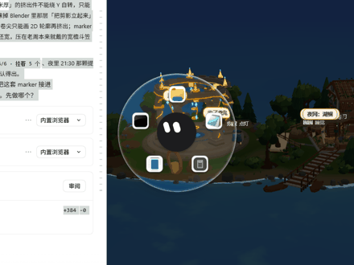
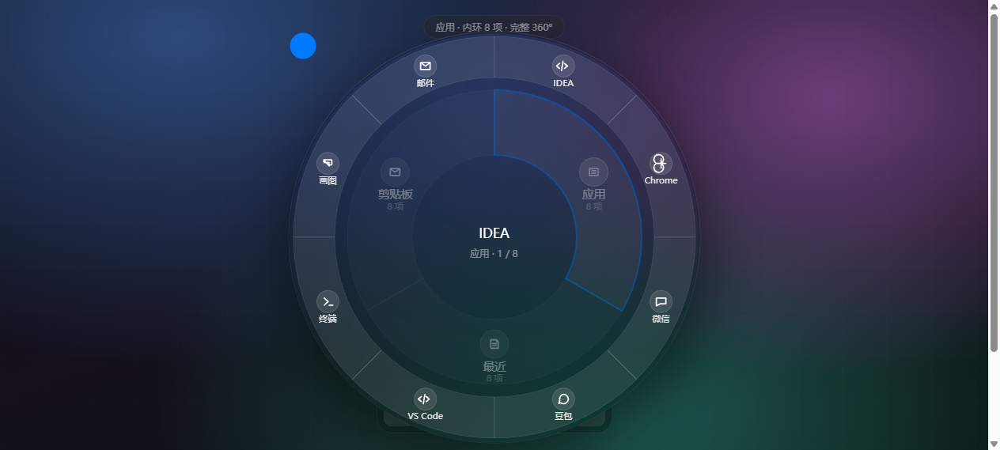
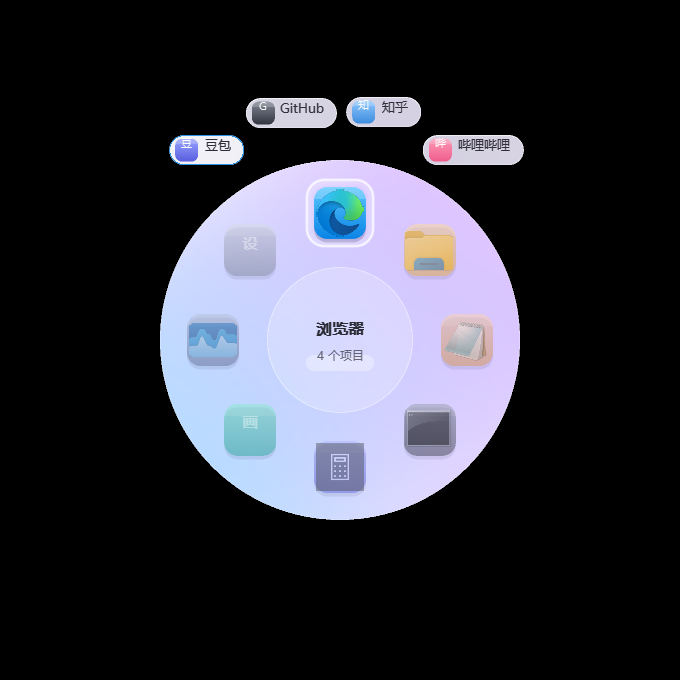
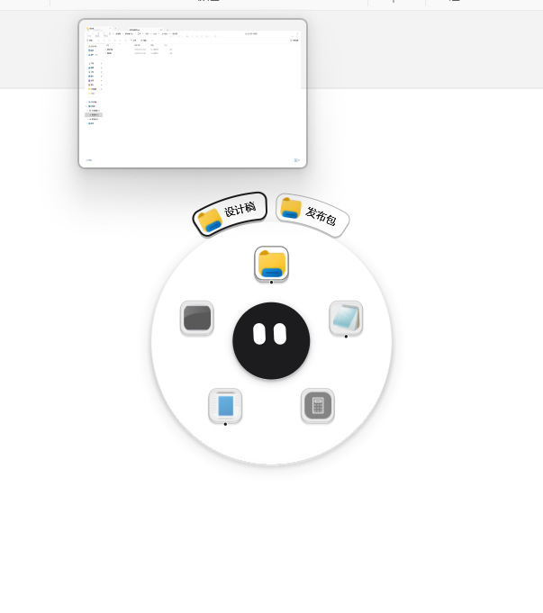
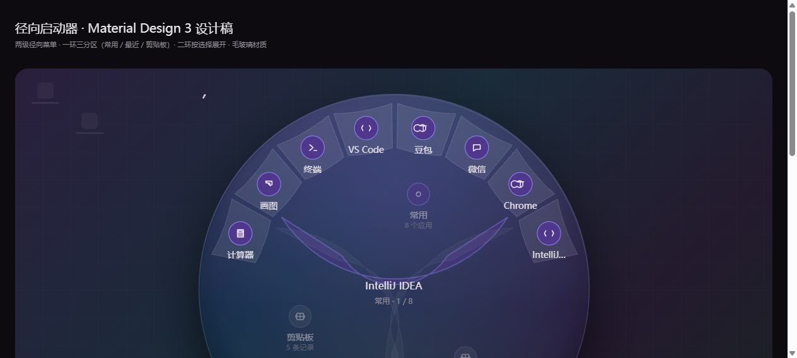

# pigo

<p align="left">
  <a href="https://github.com/lifeFxxker/pigo/releases"></a>
  
  
  
</p>

**[English](README.en.md) · [简体中文](README.md)**

Windows 平台的光标居中径向启动器。按住鼠标中键在光标处呼出轮盘，把常用应用钉在内环，悬停应用即在其身侧展开该应用的窗口，并显示实时窗口预览。单个原生可执行文件，无运行时、无安装程序。

---

## 演示



悬停应用，外环展开它的窗口；按住内环图标拖动即可排序（插入式，非简单交换）。

## 截图

| 内环 | 外环 —— 某应用的打开窗口 |
| :---: | :---: |
|  |  |
| 正在运行的应用，图标下方有一个圆点。 | 悬停应用，它的窗口就以胶囊形式贴着它展开。 |

| 实时窗口预览 | 设置 |
| :---: | :---: |
|  |  |
| 悬停窗口胶囊，显示 DWM 实时缩略图。 | 扁平、纸面风格的偏好设置。 |

## 特性

- **光标居中** —— 轮盘就在指针处弹出，不用把鼠标挪到屏幕角落。
- **双层布局** —— 内环放固定的应用；外环把当前悬停应用的窗口展开成胶囊，贴着这个应用排列，而不是散满整圈。
- **拖入即整理** —— 把快捷方式、`.exe`、文件夹或文件拖到内环即可固定。排序、重命名、移除都在同一界面完成。
- **实时窗口预览** —— 悬停窗口胶囊即可看到该窗口的实时画面（`DwmRegisterThumbnail`），最小化的窗口也有画面。视频与动画都是活的，不是截图。
- **运行中标识** —— 有窗口打开的应用，图标下方会显示一个小圆点。
- **液态玻璃材质** —— 只在轮盘上做很淡的玻璃质感；设置页保持纸面，保证可读性。
- **内置动作** —— 例如 `@act:start`，直接打开 Windows 开始菜单。
- **多种呼出方式** —— 鼠标中键、侧键、长按右键，或录制一个组合键（如 `Ctrl+W`）。
- **常驻与开机自启** —— 可设为登录时启动，常驻托盘。
- **单文件、零依赖** —— 构建产物只有一个 `Pigo.exe`（约 700 KB），不需要 .NET 或其它运行时。

## 安装

### 下载

从 [Releases](https://github.com/lifeFxxker/pigo/releases) 页下载最新的 `pigo-vX.Y.Z-win64.zip`，解压到任意目录，运行 `Pigo.exe` 即可。

> 若尚无 Release，可自行本地构建（见下）。

### 从源码构建

**前置条件**

- Windows 10 / 11，**x64**
- [Rust](https://rustup.rs/)（edition 2021）
- MSVC 工具链 —— Visual Studio Build Tools，或 `winget install Microsoft.VisualStudio.BuildTools`
- Windows SDK —— 用于嵌入 exe 图标；缺失时跳过图标步骤，构建仍可成功

```bash
cargo build --release
# -> target/release/Pigo.exe
```

> **务必保留 `Cargo.toml` 中的 `lto = "thin"`。** 不要改成 fat LTO（`"true"`）：当前工具链会错误编译本项目的 `unsafe` FFI，导致启动即崩溃（`0xC0000409`）。

打包成单文件 zip：

```bash
python package.py
# -> dist/Pigo.exe  与  dist/pigo-v1.0.0-win64.zip
```

## 使用

- **呼出** —— 按住**鼠标中键**（或侧键）在光标处弹出轮盘。松开即启动高亮的应用，按 `Esc` 或任意其它键取消。可在设置中改为长按右键或自定义组合键。
- **固定应用** —— 把快捷方式、`.exe`、文件夹或文件拖到内环磁贴上。
- **添加窗口** —— 把一个窗口拖到轮盘上，归到它所属的应用下；之后会出现在该应用的外环。
- **预览** —— 悬停应用展开它的窗口；悬停窗口胶囊显示实时预览。
- **设置** —— 从托盘图标打开（右键 → 设置…）。设置页是扁平纸面，刻意不用玻璃。

## 配置

配置位于 `%APPDATA%\pigo\settings.ini`，首次运行自动创建，通常通过应用内设置页编辑即可。日志写入 `%LOCALAPPDATA%\pigo\logs\`。

## 实现原理

- **纯 Win32 + `windows-rs`** —— 不使用 UI 框架，自带软件渲染器，因此体积小、启动快、无运行时依赖。
- **分层窗口** —— 轮盘通过 `UpdateLayeredWindow` 以预乘 alpha 呈现。玻璃材质会采样轮盘背后的桌面，所以每次呼出都会重新抓取。
- **预览是 DWM 缩略图** —— 分层窗口不能作为 DWM 缩略图源，因此预览由一个独立的普通顶层窗口通过 `DwmRegisterThumbnail` 渲染。画面是实时的而非静态截图，最小化的窗口也保留着最后一帧。
- **绘制与命中共用一套布局** —— 内环与外环胶囊使用同一个布局函数，所见即所得，点到即所见。

## 项目结构

```
src/main.rs            全部逻辑 —— 原生 Win32 + 软件渲染器
app.rc / app.ico       exe 版本信息与图标
build.rs               通过 Windows SDK 的 rc.exe 嵌入图标（缺失则跳过）
package.py             一键打包为 zip
tools/                 开发期工具（图标生成 / 日志分析 / 截图与发布脚本，均为可选）
design/preview-*.png   README 使用的截图
```

## 许可证

[MIT](LICENSE) © 2026 pigo
